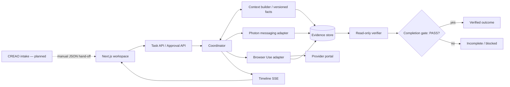

# Orbit

**From “I'll get back to you” to “It's handled.”** Orbit turns a desired outcome into a coordinated workflow with explicit boundaries, approval of exact terms, and evidence before completion. The MVP coordinates a dishwasher diagnostic visit: compare providers, adapt to a surprise fee, request approval, submit through a provider portal, and independently check the result. Parts and labor remain unknown until diagnosis.

## Current build status

The frontend and offline demonstration are implemented. This checkout's backend is the CP0 skeleton: `/demo/seed` is implemented, while task, approval, stream, and demo-control routes return 501. A working frontend mock is **not** proof of a working backend, sponsor integration, or independent verifier. Real-backend acceptance remains pending the team integration.

| Subsystem | Status in this hand-off |
| --- | --- |
| Next.js intake, task workspace, approvals, evidence, verification | Implemented; supports typed backend HTTP/SSE and an explicit offline mode |
| Offline provider messages and portal outcomes | Synthetic fixture snapshots; no external action |
| Context, coordinator, independent verifier | Shared contract consumed by UI; implementation belongs to teammates |
| Photon / Browser Use live execution | Not validated in this hand-off; runtime chips report the backend's status |
| CREAO | Workflow checklist and JSON import implemented; no actual platform execution claimed |

`docs/integrations.md` is owned by Ansh and was absent at this hand-off. Reconcile this table with that document and recorded live runs before submission.

## Why this exists

A service visit involves more than finding a provider. Someone must reconcile conflicting quotes, spot hidden travel fees, preserve constraints, ask permission, and check that the actual result matches the decision. Orbit makes those steps visible instead of hiding them behind a confident sentence.

The intended system has three responsibilities:

1. **Context Intelligence Layer:** versioned facts with source references, domain rules, and conflicts.
2. **Adaptive Coordination Engine:** durable steps, approval binding, replanning, and ambiguous-action recovery.
3. **Independent Verification Agent:** read-only evidence checks returning PASS, FAIL, or INSUFFICIENT_EVIDENCE. The completion gate requires PASS.



This diagram describes the team architecture; it is not a claim that the CP0 backend has implemented every box. See [architecture notes](docs/architecture.md).

## Run the frontend now

Node 20.9+ is required; use a supported Node 22 LTS release for the toolchain.

```sh
cd frontend
npm ci
cp .env.example .env.local
npm run dev
```

Open http://localhost:3000. The frontend example sets `NEXT_PUBLIC_USE_MOCKS=1` and `NEXT_PUBLIC_API_BASE=http://localhost:8000`. Only the seeded repair scenario is simulated. The UI is labelled throughout and stops at approval cards; it never approves automatically.

For the integrated stack after the backend is ready:

```sh
python3 -m venv .venv
source .venv/bin/activate
cp .env.example .env
make install
# In frontend/.env.local set NEXT_PUBLIC_USE_MOCKS=0
make dev
```

Ports: frontend 3000, backend 8000, provider portal 8100. Root `.env` settings do not automatically populate Next.js; use `frontend/.env.local` or exported environment variables. Restart/rebuild the frontend after changing public variables. Do not put secrets in `NEXT_PUBLIC_*` values.

## Demonstrate the twist

1. Start a fixture task. Wait for Ace's $120.00 approval card.
2. Open **Presenter controls**, then inject the $70.00 trip charge (**Shift+1** outside text fields).
3. Show $120.00 struck through, $190.00 active, over-budget reasoning, the withdrawn approval, and plan v2.
4. Optionally inject the duplicate message; the timeline retains duplicate-ignored events.
5. Approve Bayside's exact $145.00 terms. The mock progresses to illustrative verification and “Handled ✓”.
6. Reset (**Shift+R**) and set a portal fault before approving Bayside. `mismatch` shows FAIL; `no_confirmation` shows insufficient evidence; `timeout_after_submit` shows reconciliation without duplicate submission.

Backend reset clears shared demo DB/artifacts/portal state and requires `ORBIT_ALLOW_RESET=1`. Mock reset creates a fresh tab-local story. Mock fault outcomes are scripted UI demonstrations, not tests of real adapters or verifier predicates.

## Evidence standard

| Observation | UI claim |
| --- | --- |
| Adapter submitted a message | Message submitted |
| Delivery receipt | Message delivered |
| Provider offered a time | Slot offered |
| Booking request submitted | Booking request submitted |
| Independent verdict PASS | Booking verified |
| Evidence missing / conflicting | Verification pending / failed |
| Task COMPLETED **and** verdict PASS | Handled ✓ |

Fixture banners trigger on task mode, any fixture artifact, or any fixture integration status. Approval decisions send the exact displayed proposal hash. HTTP 409 shows “Terms changed” and refreshes the proposal. Times use the task timezone with zone labels; money is integer cents formatted as USD.

## Validate

```sh
cd frontend
npm run lint
npm run typecheck
npm test
npm run build
npx playwright install chromium
npm run test:e2e
# Or use installed Chrome:
PLAYWRIGHT_CHANNEL=chrome npm run test:e2e
```

From the root, `make test` runs the team's backend tests; it does not currently run frontend checks. Do both before proposing a merge. Browser tests cover the full fixture story and mismatch path on desktop and a 390px phone viewport.

## Team, integrations, and submission

| Owner | Responsibility |
| --- | --- |
| Adithya | Frontend, CREAO checklist/workflow, demo and submission story |
| Victor | Core backend, coordinator, approvals, state and shared contracts |
| Karthik | Context, domain pack, extraction and independent verifier |
| Ansh | Messaging/browser integrations and provider portal |

Photon and Browser Use are intended live integrations; evidence of their actual execution must come from the integrated build. CREAO's current hand-off is manual JSON import; [the execution checklist](creao/README.md) explains how to build and capture a real connected workflow. No sponsor eligibility is claimed until confirmed.

Planning briefs were prepared before the event and should be disclosed on Devpost. Coding eligibility and deadlines require organizer confirmation; see [open questions](docs/organizer_questions.md). [Devpost draft](docs/devpost.md), [3-minute recording script](docs/demo_script.md), [judge Q&A](docs/judge_qa.md), and [acceptance hand-off](docs/frontend_handoff.md) are ready for review. No video upload or Devpost submission has been performed by this implementation.
