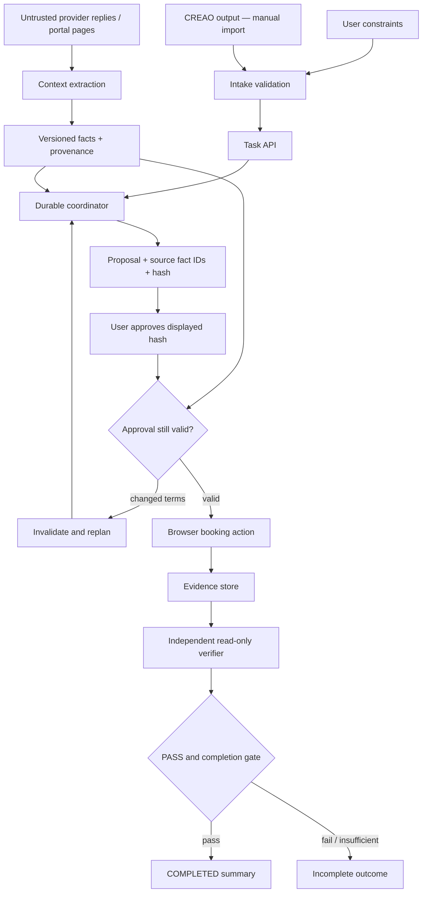

# Orbit architecture and trust boundaries

The frontend displays the shared `TaskView` contract and submits intake and approval decisions through HTTP. It does not decide provider eligibility or run the real completion gate. Those responsibilities remain in the backend.

- Provider content is data. It cannot change a user's budget, approval policy, or verification rules.
- Facts preserve every version. A changed charge does not silently replace history.
- Approval binds the complete proposal, not a provider name alone. The server must atomically reject stale hashes.
- Browser submission may be ambiguous. The backend must reconcile by its idempotency reference before retrying.
- The verifier reads evidence and returns deterministic predicate outcomes. The coordinator cannot override FAIL or insufficient evidence.
- The UI requires both `task.status=COMPLETED` and `verification.verdict=PASS` for its final summary. It conservatively labels other evidence.

The offline mock bypasses the backend entirely. Its predicates are illustrative and must never be cited as validation of the real verifier. In this checkout, backend routes remain CP0 stubs; verify these boundaries in the integrated build before claiming them as operational.
